# PolicyGPT

PolicyGPT is a secure, full-stack web application designed to empower citizens, government officials, and administrators to access, search, analyze, and manage government welfare policies, programs, circulars, and public schemes. It simplifies the discovery and comprehension of government information through AI-powered search, eligibility checking, and structured comparisons.

---

## 1. Project Overview & Objective

Government policies, welfare schemes, notifications, and regulations are often spread across lengthy and complex documents, making it difficult for citizens and other stakeholders to find and understand relevant information. PolicyGPT addresses this problem by:
- Providing a centralized, user-friendly platform to browse, search, and understand government policies and schemes.
- Using AI-powered Retrieval-Augmented Generation (RAG) to answer user queries in natural language with relevant, citation-based information.
- Helping citizens identify eligible and relevant government schemes based on their profile and requirements.
- Providing semantic search and document retrieval across government policy documents, schemes, and circulars.
- Offering dedicated dashboards for citizens, government officers, and administrators to monitor information, activities, and analytics.
- Providing notifications and alerts for policy updates, scheme changes, circulars, and important announcements.
- Enabling administrators to manage policies, schemes, documents, users, reports, and platform analytics.

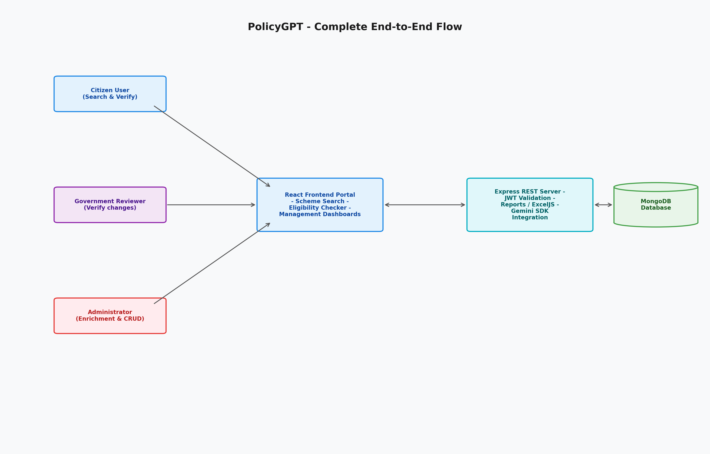
*Figure 1: Complete end-to-end user and system interactions.*

---

## 2. Key Features

- **Landing Page & Navigation**: Contains featured schemes, categorizations (Education, Health, Agriculture, Housing, etc.), policy updates, FAQ guides, and direct navigation links.
- **Citizen Dashboard**: Access to profile management, saved/bookmarked schemes, recent search history list, custom feedback submission, and inbox notifications.
  
  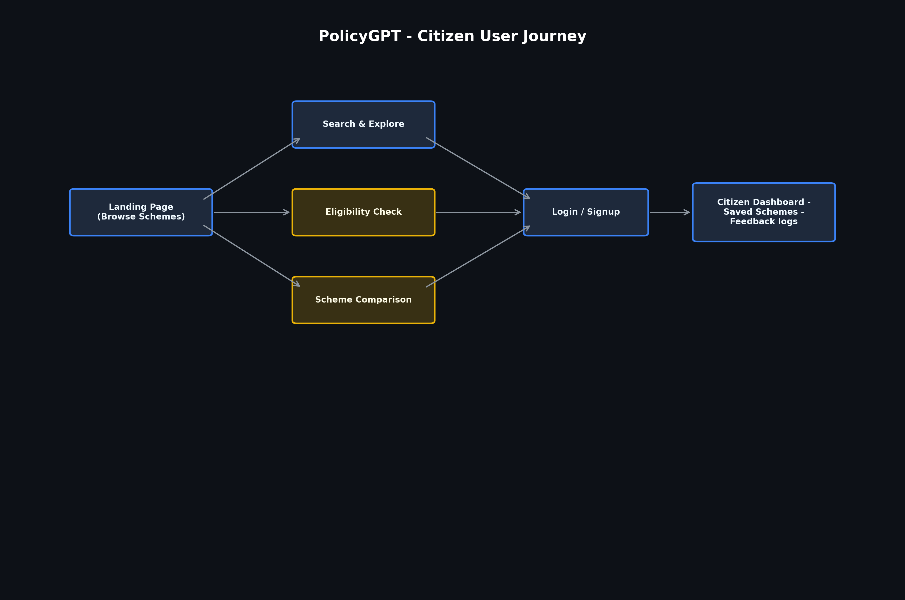
  *Figure 2: Outlines the citizen user journey from landing page browsing through search, comparison, and eligibility checking.*

- **Eligibility Checker**: A questionnaire-driven checking module that compares profile characteristics against rules in real-time, outputting percentage matches and compliance lists.
  
  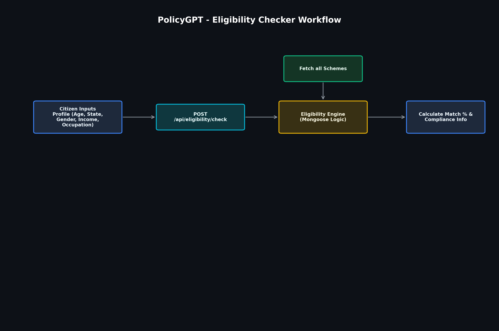
  *Figure 3: Visualizes the questionnaire-driven eligibility checking process.*

- **Scheme Comparison**: Allows side-by-side analysis of up to 3 schemes across fields such as target beneficiary, max benefit, transfer mode, and application fees.
  
  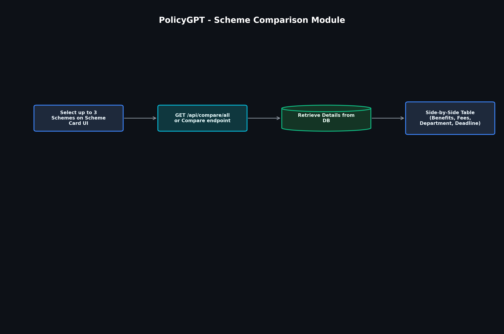
  *Figure 4: Shows the comparison flow mapping selected schemes into a side-by-side comparative table.*

- **Admin Management Panel**: Direct CRUD interfaces for managing policies, schemes, documents, users, auditing feedback logs, downloading detailed Excel/PDF reports, and viewing system usage analytics.
  
  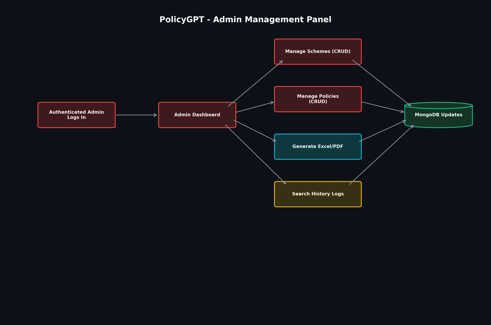
  *Figure 5: Summarizes the actions available on the administrator panel.*

- **Government Officer Dashboard**: Dedicated review interface for government officers to monitor scheme updates, review activities, check reports, and track policy/announcement alignments.
  
  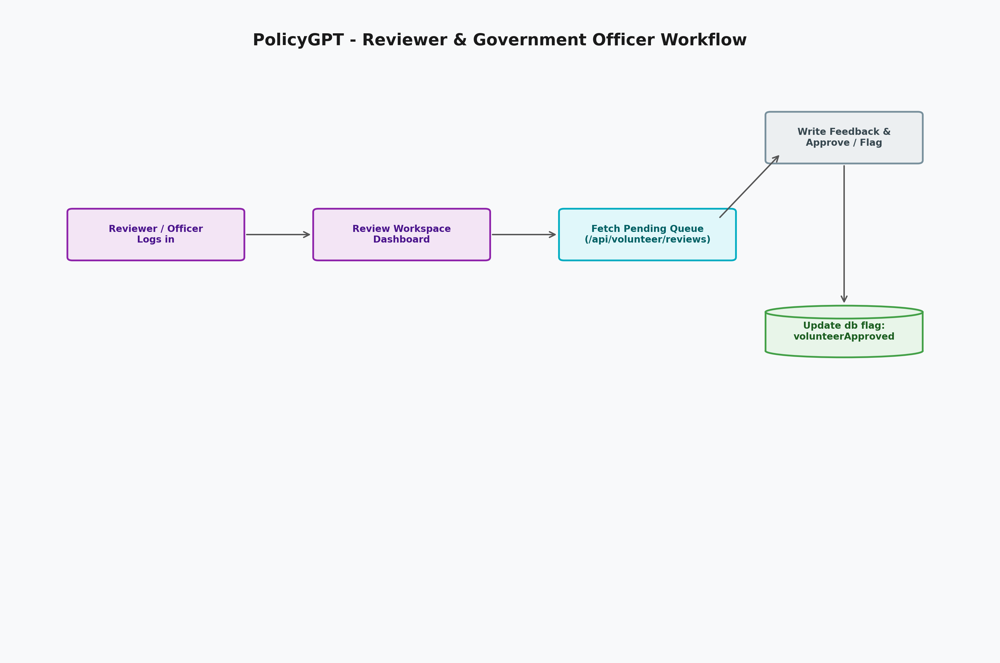
  *Figure 6: Illustrates the government reviewer's workflow for inspecting pending schemes and policies.*

- **Natural Language Search Logging**: Matches keywords against schemas via regex, tracking response time latencies, matches, and success rates.

---

## 3. Tech Stack

### Frontend
- **Framework**: React.js (Vite configuration)
- **Styling**: Tailwind CSS
- **Routing**: React Router Dom (v7)
- **Icons**: Lucide React & React Icons
- **Visualizations**: Recharts (for dashboard analytics graphs)
- **HTTP Client**: Axios

### Backend
- **Framework**: Node.js & Express.js
- **Database**: MongoDB (Mongoose ORM)
- **Logging**: Morgan
- **Security**: Bcrypt.js & JsonWebToken (JWT)
- **Utility Tools**: ExcelJS (Excel sheets generator), PDFKit (PDF reports builder), Nodemailer (notification handler)

### AI & Data Processing
- **AI Integration**: `@google/genai` SDK (`gemini-2.0-flash`)
- **LLM Grounding**: Google Search tool integration (for database enrichment)

---

## 4. System Architecture

PolicyGPT follows a classic client-server architecture communicating via REST APIs. Below is the interaction flowchart:

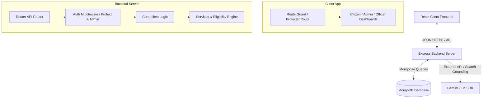

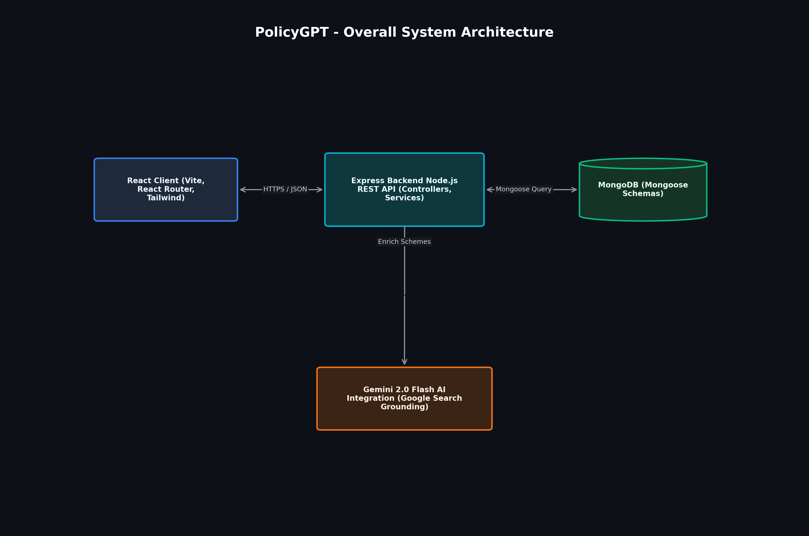
*Figure 7: System architecture and layout of client, backend, database, and LLM components.*

---

## 5. Project Folder Structure

```
GPPSIP_Team2/
├── client/                      # Frontend Application
│   ├── src/
│   │   ├── assets/              # Static media assets and icons
│   │   ├── components/          # Reusable UI components
│   │   │   ├── admin/           # Admin dashboard tables & managers
│   │   │   ├── auth/            # ProtectedRoute and authentication overlays
│   │   │   ├── landing/         # Homepage sections
│   │   │   ├── navbar/          # Sidebar & header navigation components
│   │   │   └── ui/              # Base UI components (SchemeCard, StatCards)
│   │   ├── context/             # React Context providers (AuthContext.jsx)
│   │   ├── data/                # Static local data (landingData.js, schemesData.js)
│   │   ├── hooks/               # Core custom hook declarations
│   │   ├── pages/               # Top-level page views (Dashboard, Details, Checker)
│   │   ├── routes/              # Client-side router configuration (AppRoutes.jsx)
│   │   ├── services/            # API client service classes (apiClient.js, schemeService.js)
│   │   └── utils/               # Constants and helper functions
│   ├── package.json
│   └── vite.config.js
│
└── Server/                      # Backend REST API Application
    ├── config/                  # DB and Environment definitions (db.js, env.js)
    ├── controllers/             # Express API controllers handling endpoints
    ├── data/                    # JSON datasets (schemes, policies)
    ├── middleware/              # Auth checking & error handling middleware
    ├── models/                  # Mongoose MongoDB schemas
    ├── routes/                  # Express endpoint paths definitions
    ├── scripts/                 # Admin, analytics, seed, & AI enrichment scripts
    ├── services/                # Backend business logic & eligibility calculators
    ├── utils/                   # Database seeding script & generic helpers
    ├── .env                     # Configuration file (ignored in git)
    └── package.json
```

---

## 6. Frontend & Backend Architecture

### Frontend Architecture
- **State Management**: Uses React Context (`AuthContext.jsx`) for managing authentication states and profile tokens.
- **Route Guarding**: [ProtectedRoute.jsx](file:///c:/Users/Sheetal/OneDrive/Desktop/info/GPPSIP_Team2/client/src/components/auth/ProtectedRoute.jsx) intercepts private navigation paths (`/citizen/dashboard`, `/admin/dashboard`, etc.) and redirects unauthorized sessions to the login portals.
- **Service Layer**: Decoupled HTTP API requests inside the `client/src/services/` folder using Axios, creating client handlers like `schemeService`, `compareService`, and `authService`.

### Backend Architecture
- **Router Pattern**: Mounted under `/api/`, individual route managers handle different namespaces (`/api/auth`, `/api/schemes`, `/api/policies`, `/api/volunteer`, etc.) and pass control through middlewares to controllers.
- **Middlewares**:
  - `protect`: Validates the client's JWT token and sets `req.user` with user credentials.
  - `admin`: Verifies that `req.user.role === 'admin'`.
  - `asyncHandler`: Catches runtime server errors in async/await logic blocks and routes them to the central error-handling wrapper.
- **Controllers**: Extends logic from routes to query the models, process requests, and send responses.

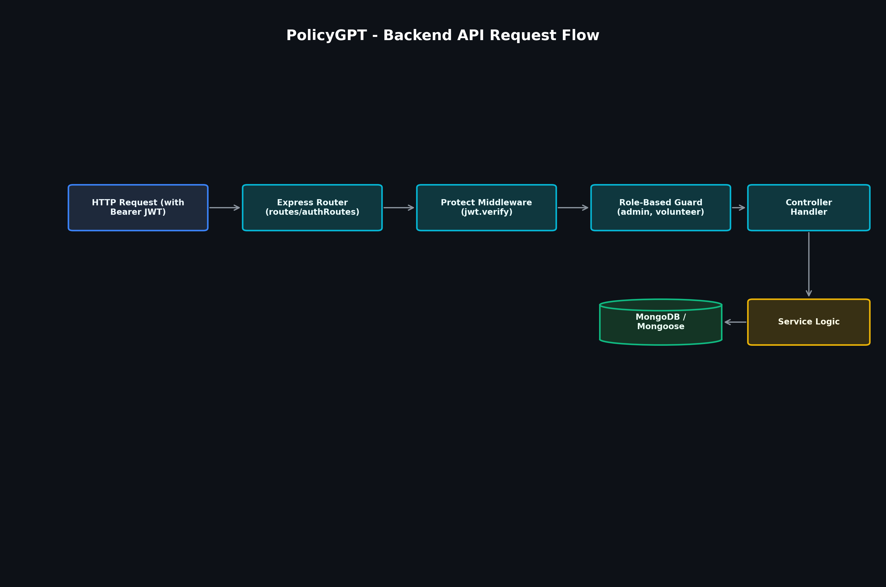
*Figure 8: Backend REST API request execution path showing router, auth validation, role guards, and services.*

---

## 7. Database Models

- **User**: Manages user profiles (email, mobile, hashedPassword, fullName, state, occupation, incomeRange) and security roles (`citizen`, `admin`, `volunteer`).
- **Scheme**: Stores government scheme objects. Includes parameters for department, category, objectives, annualBenefit, beneficiaries, deadline, eligibility criteria guidelines, and reviews audit logs.
- **Policy**: Manages legislative policies, timelines, visions, objectives list, affected target groups, and FAQs.
- **Application**: Tracks scheme applications submitted by citizens, linking users to schemes and tracking status (`Submitted`, `Under Review`, `Approved`, `Rejected`).
- **AiQueryLog**: Saves natural language search entries for dashboard graph visualizations, documenting parameters like query strings, latency speed, category classifications, and matched items.
- **SavedScheme**: Junction table tracking saved/starred schemes per citizen.
- **Feedback**: Stores citizens' dashboard feedback logs.
- **Otp**: Houses active temporary OTPs and expiration dates.
- **ReportHistory**: Audits administrative data reports exported.

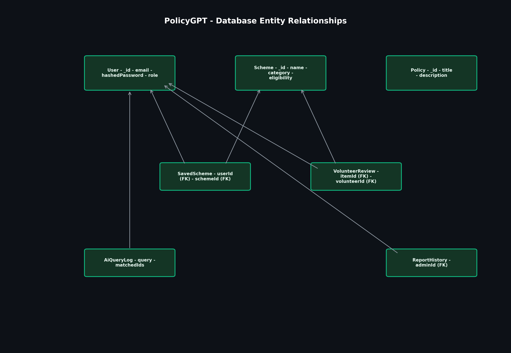
*Figure 9: Mongoose schema collections layout and entity relationships in MongoDB.*

---

## 8. PolicyGPT Search Retrieval Pipeline

The natural language search matches queries against MongoDB collections using exact keyword patterns:

1. **User Query Input**: The citizen submits a natural language search query (e.g. "PM Kisan loan").
2. **Text Retrieval Matching**: The backend performs queries against MongoDB using case-insensitive `$regex` matches on scheme titles, names, and description fields:
   ```javascript
   const matchedSchemeObj = await Scheme.findOne({
     $or: [
       { name: { $regex: queryText, $options: "i" } },
       { title: { $regex: queryText, $options: "i" } },
       { description: { $regex: queryText, $options: "i" } }
     ]
   });
   ```
3. **History Logging**: The query gets persisted inside the `AiQueryLog` collection to populate administration analytics counters.
4. **Result Delivery**: Matching schemes are returned to the client and highlighted in the explorer UI.

*Note: Vector databases, chunking text, and embedding vector matching pipelines are not active in this codebase release. All search matches are regex-driven database queries.*

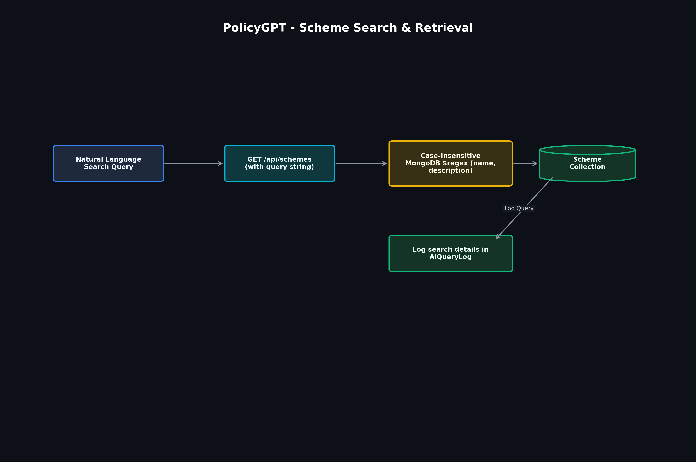
*Figure 10: Natural language keyword matching and query analytics logging pipeline.*

---

## 9. Data & Gemini LLM Enrichment Pipeline

PolicyGPT utilizes a database enrichment module powered by the Gemini LLM with Google Search Grounding to audit and automatically enrich schemes with verified details:

1. **Thin Field Identification**: The developer runs [enrichSchemesWithGemini.js](file:///c:/Users/Sheetal/OneDrive/Desktop/info/GPPSIP_Team2/Server/scripts/enrichSchemesWithGemini.js), which scans MongoDB for schemes with missing or short descriptions, eligibility criteria, benefits, helplines, or application steps.
2. **LLM Query & Grounding**: For each missing field, the script constructs a search prompt and calls the `gemini-2.0-flash` model with Google Search grounding enabled:
   ```javascript
   const response = await ai.models.generateContent({
     model: "gemini-2.0-flash",
     contents: prompt,
     config: { tools: [{ googleSearch: {} }] }
   });
   ```
3. **Verification & Update**: The retrieved information is validated and saved back to the database, ensuring accurate and up-to-date scheme information for citizens.

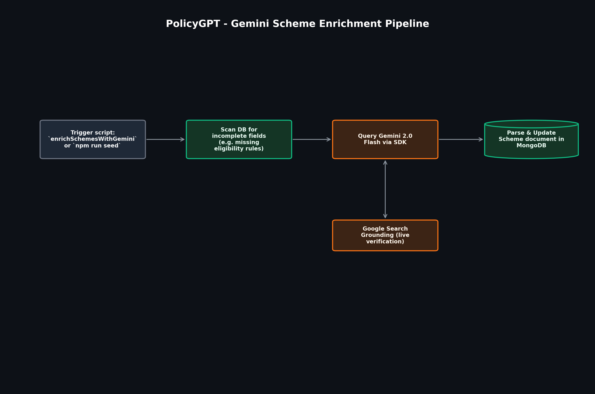
*Figure 11: Schema database enrichment workflow using Gemini 2.0 Flash and Google Search Grounding.*

---

## 10. API Route Reference

### Authentication (`/api/auth`)
- `POST /register` – Register a new account.
- `POST /login` – Authenticate credentials and return JWT token.
- `POST /send-otp` – Generate and send a one-time passcode.
- `POST /verify-otp` – Validate OTP code.
- `POST /reset-password` – Reset password using validated credentials.
- `GET /me` – Retrieve profile credentials for the logged-in user.

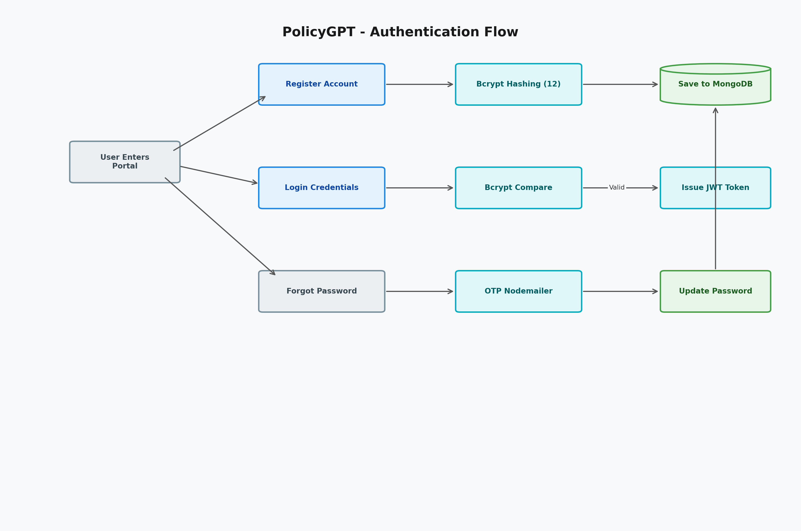
*Figure 12: Detailed authentication process including hashing, validation, JWT token creation, and OTP recovery.*

### Schemes (`/api/schemes`)
- `GET /` – Fetch all schemes (optional query filters: `status`, `department`).
- `GET /public/featured` – Retrieve the 6 featured homepage schemes.
- `GET /:id` – Fetch single scheme details.
- `POST /` – Create a new scheme (Admin only).
- `PUT /:id` – Update scheme details (Admin only).
- `DELETE /:id` – Delete a scheme (Admin only).
- `POST /:id/save` – Bookmark/save a scheme.
- `DELETE /:id/save` – Unsave/remove bookmark.
- `GET /:id/is-saved` – Check if a scheme is saved.
- `POST /search-history` – Add query to user search history.

### Policies (`/api/policies`)
- `GET /` – Fetch all legislative policies.
- `GET /:id` – Fetch policy details.
- `POST /` – Create a new policy (Admin only).
- `PUT /:id` – Update a policy (Admin only).
- `DELETE /:id` – Delete a policy (Admin only).

### Eligibility Checker (`/api/eligibility`)
- `POST /check` – Match citizen profile data against scheme rules.
- `GET /schemes` – Fetch list of schemes for the checker.
- `POST /seed` – Seed eligibility test schemes.

### Scheme Comparison (`/api/compare`)
- `GET /all` – Retrieve comparison datasets.
- `POST /` – Request comparative calculations.

### Government Officer / Reviewer Queue (`/api/volunteer`)
- `GET /dashboard` – Fetch stats for the review workspace.
- `GET /reviews/policies` – Fetch policies awaiting review.
- `GET /reviews/schemes` – Fetch schemes awaiting review.
- `POST /reviews/:type/:id` – Submit review approval/feedback.

### Reporting & Analytics (`/api/reports` & `/api/analytics`)
- `POST /reports/generate` – Export system report (PDF/Excel) (Admin only).
- `GET /reports` – View history of generated reports (Admin only).
- `GET /reports/download/:id` – Download generated report by ID (Admin only).
- `GET /analytics` – Retrieve search analytics logs and metadata (Admin only).

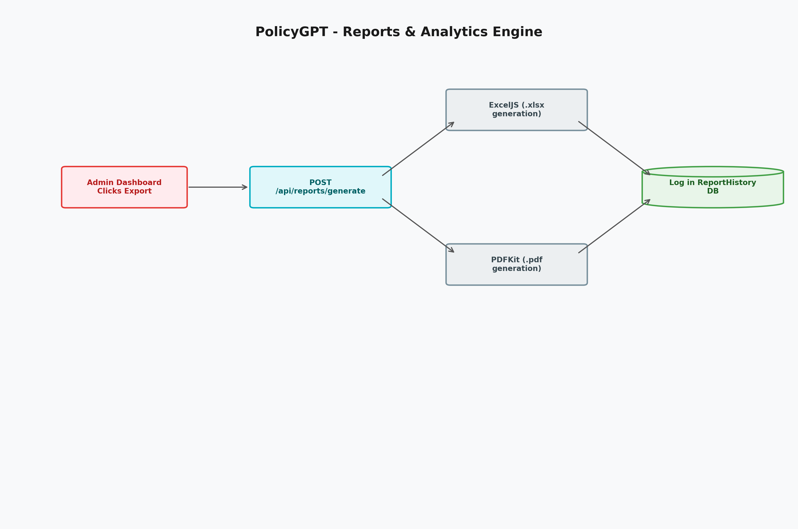
*Figure 13: Report generation pipeline using ExcelJS/PDFKit and tracking report logs.*

---

## 11. Environment Variables & Setup

### Environment Variables
Create a `.env` file inside the `Server/` directory containing the following:

```env
MONGO_URI=mongodb://localhost:27017/gppsip
PORT=5000
JWT_SECRET=your_jwt_signing_secret_key
JWT_EXPIRES_IN=7d

# SMTP Configuration
SMTP_HOST=smtp.gmail.com
SMTP_PORT=587
SMTP_SECURE=false
SMTP_USER=your_email@gmail.com
SMTP_PASS=your_app_password
SMTP_FROM=your_email@gmail.com

# Gemini LLM Integration
GEMINI_API_KEY=your_google_gemini_api_key
```

### Installation & Run

1. **Install Server Dependencies**:
   ```bash
   cd Server
   npm install
   ```

2. **Seed MongoDB Database**:
   Seeding consists of three specific commands to populate schemes, policies, and the volunteer reviewer account:
   - **Seed Schemes & Dashboard Logs**: Seeds the base schemes dataset and initializes 180 mock analytics logs for the dashboard graph visualizations.
     ```bash
     npm run seed
     ```
   - **Seed Legislative Policies**: Seeds the legislative policies records.
     ```bash
     npm run seed:policies
     ```
   - **Seed Volunteer Account**: Seeds the sample volunteer reviewer profile (`volunteer@policygpt.in` with password `Volunteer@123`).
     ```bash
     node scripts/seedVolunteer.js
     ```

3. **Start Backend Server**:
   ```bash
   npm run dev
   ```

4. **Install Client Dependencies**:
   ```bash
   cd ../client
   npm install
   ```

5. **Start Frontend Dev Server**:
   ```bash
   npm run dev
   ```
   Open `http://localhost:5173/` in your browser.

---

## 12. Testing & Verification

Run these validation scripts from the `Server/` folder to check data integrity:

- **Data Integrity Check**: Compares MongoDB database count and schema documents against the local `government_schemes (1).json` file:
  ```bash
  node scripts/verify_data.js
  ```

---

## 13. Security

- **Password Hashing**: Citizen and administrator passwords are automatically hashed with a salt factor of 12 using `bcryptjs` before insertion into MongoDB.
- **JWT Authorization**: Protects private APIs by validating the `Authorization` header bearer token.
- **Role Guards**: Admin-specific endpoints are guarded on the backend by verifying role claims:
  ```javascript
  export const admin = (req, res, next) => {
    if (req.user && req.user.role === "admin") {
      next();
    } else {
      res.status(403).json({ success: false, message: "Not authorized as an admin" });
    }
  };
  ```

---

## 14. Limitations & Future Enhancements

- **Dynamic Vector Search**: Implementing a true Vector DB (like Pinecone/Chroma) and embedding model (like text-embedding-004) to support semantic search.
- **SMS OTP Gateway**: Integrating a real SMS gateway service (e.g. Twilio) instead of relying solely on simulated/email-based notifications.
- **Direct Application Gateway**: Integrating with official government API gateways to allow citizens to apply for schemes directly through PolicyGPT.

---

## 15. Flowcharts & System Workflows

This section lists all system flowcharts and architectural workflow diagrams for quick reference:

1. **Overall System Architecture**: 
   *High-level system components showing React client, Express REST server, MongoDB database, and Gemini AI SDK.*
2. **Authentication Flow**: 
   *Secure user registration, Bcrypt password hashing, JWT token issue, and NodeMailer OTP recovery.*
3. **Citizen Journey**: 
   *Steps for citizens exploring schemes, checking eligibility, comparing schemes, and writing dashboard feedback.*
4. **Scheme Search / Retrieval**: 
   *Search pipeline executing exact MongoDB regex keyword matching and logging entries in analytics.*
5. **Eligibility Checker**: 
   *Dynamic questionnaire checks mapping citizen attributes (income, occupation, state) to scheme rules.*
6. **Scheme Comparison**: 
   *Matrix builder evaluating up to 3 schemes across departments, categories, benefits, and deadlines.*
7. **Admin Management**: 
   *Administrative control panel managing schemes, policies, generating reports, and tracking analytics logs.*
8. **Volunteer / Government Reviewer Workflow**: 
   *Review queue workspace permitting government officers to review pending schemes and policies.*
9. **Gemini Scheme Enrichment Pipeline**: 
   *AI-driven database enrichment using Gemini 2.0 Flash and Google Search Grounding to audit schemes.*
10. **Reports & Analytics**: 
    *Export engine generating Excel/PDF files using ExcelJS/PDFKit and tracking logs in ReportHistory.*
11. **Backend API Request Flow**: 
    *Sequential execution sequence of Express routers, protection middlewares, controllers, and services.*
12. **Database Relationship / ER Diagram**: 
    *Database entity relationships and schema definitions of primary collections inside MongoDB.*
13. **Complete PolicyGPT End-to-End Flow**: 
    *Full workflow mapping the interactions between all portal roles (Citizens, Officers, Admins) and backend systems.*
14. **Notification Flow**: 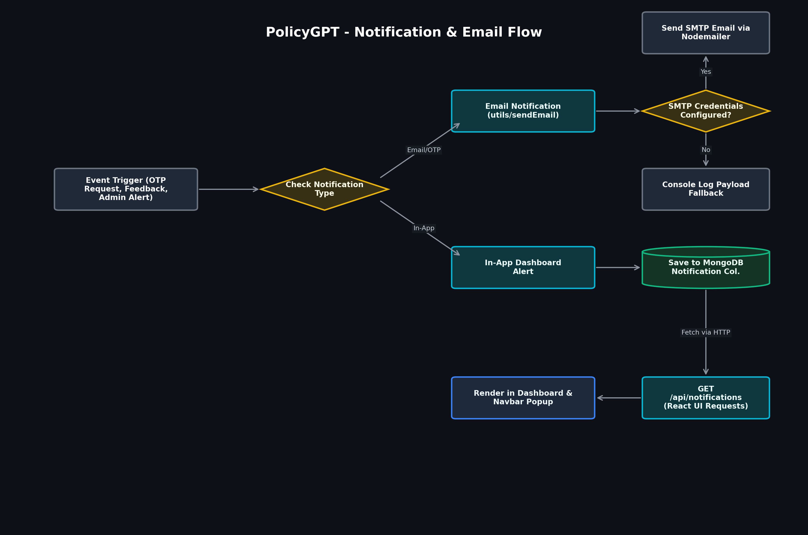
   *Visualizes the email/OTP notification system (using SMTP and Nodemailer) alongside the in-app dashboard notification collections in MongoDB.*
