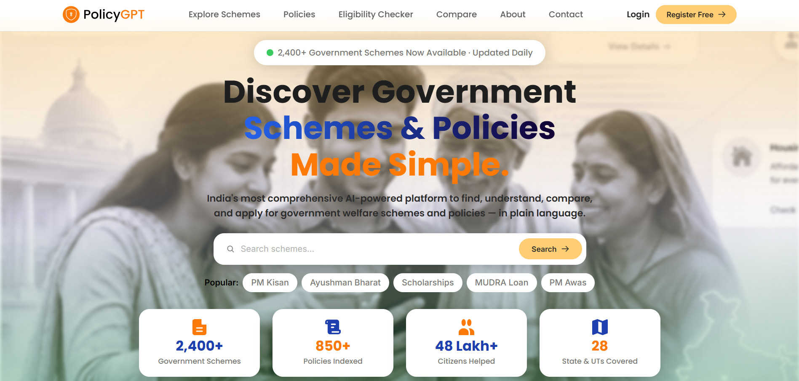
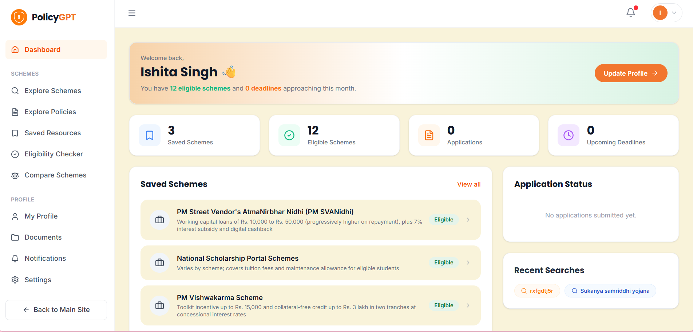
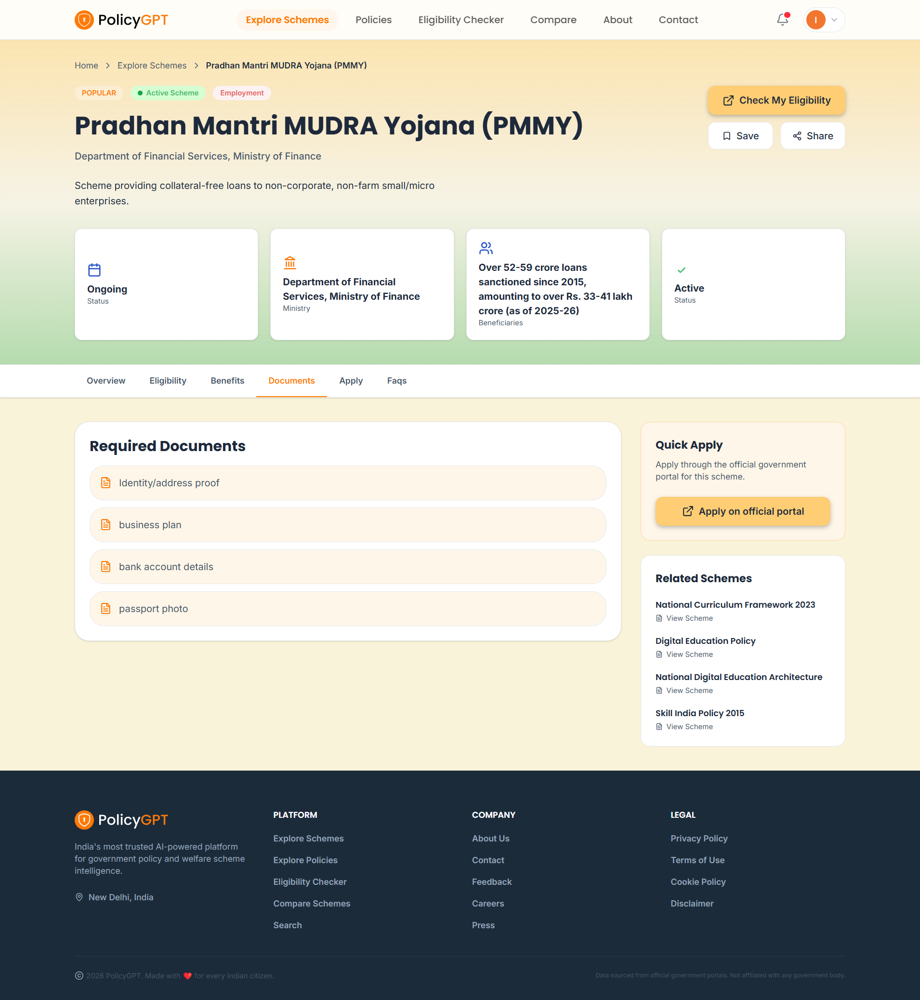
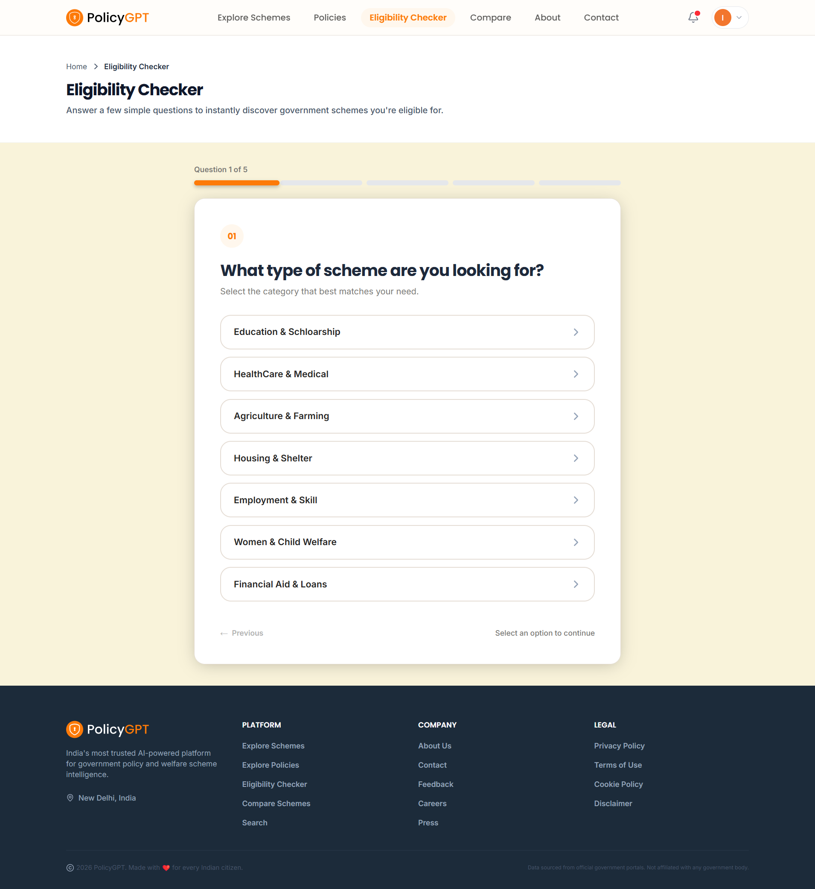
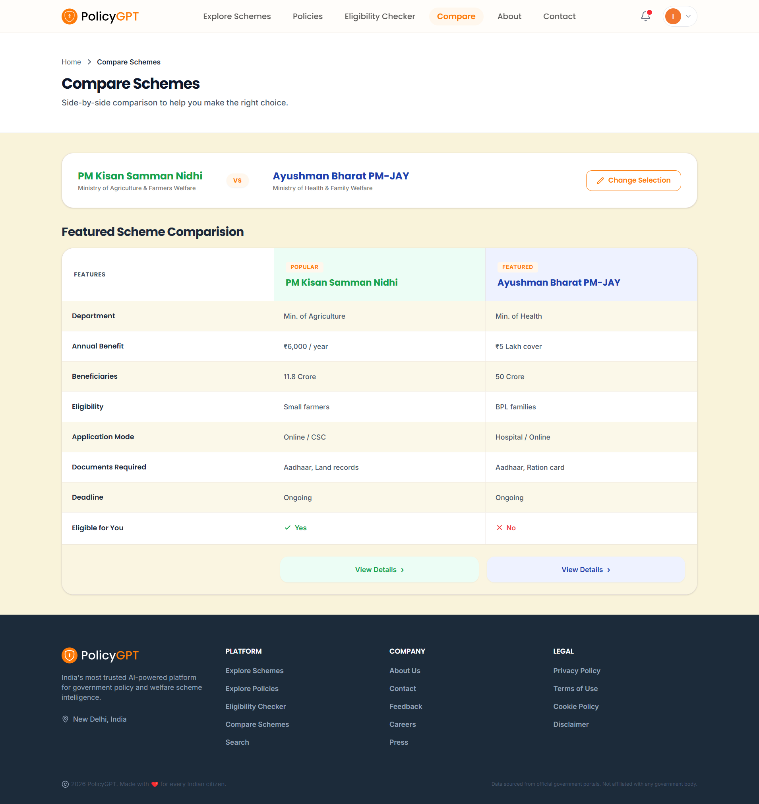
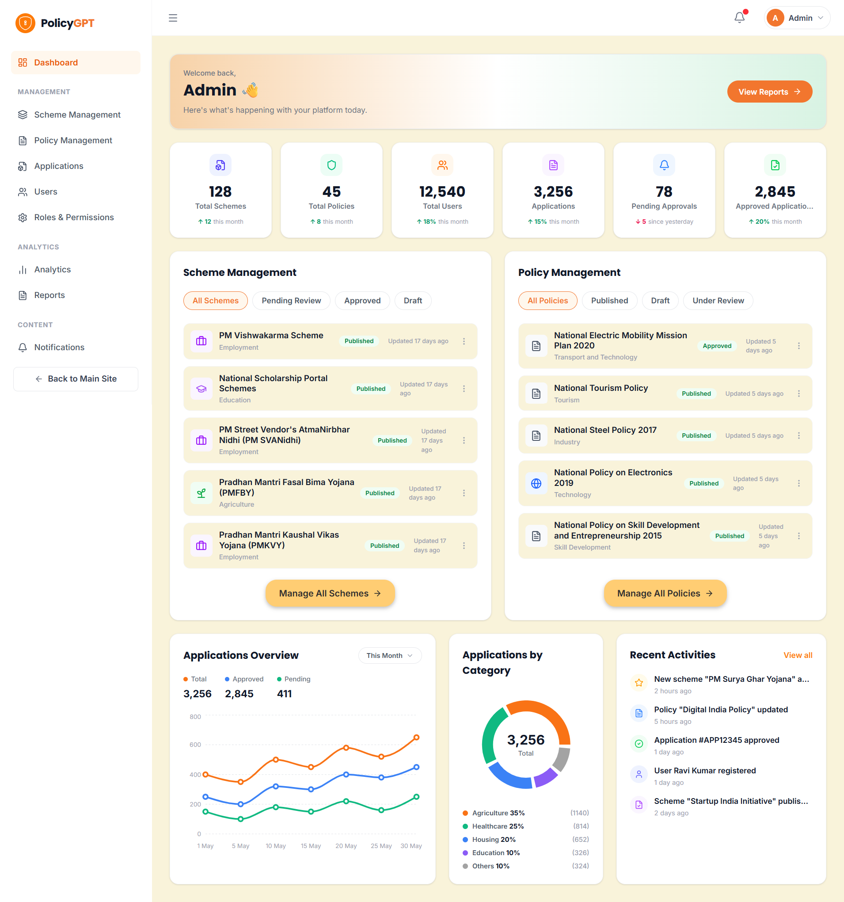
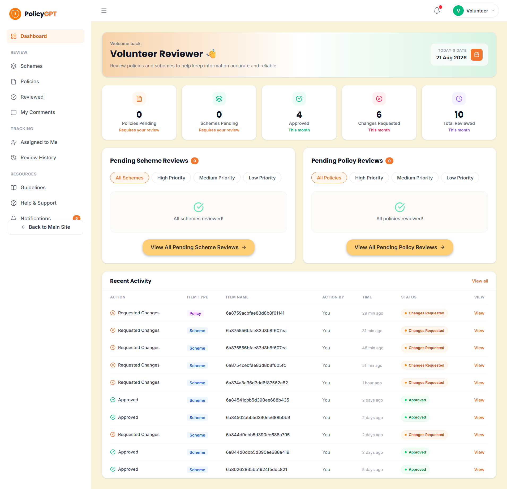

<div align="center">

# 

### Government Policy & Public Scheme Intelligence Platform

**Making government policies and public welfare schemes easier to discover, understand, and access.**

<br/>

<p align="center">
  
  
  
</p>

<p align="center">
  
  
  
  
  
  
  
</p>

</div>

---

## 📖 About

Government policies, welfare schemes, notifications, and public information are often scattered across lengthy documents and multiple sources, making them difficult to discover and understand.

**PolicyGPT** is a full-stack web platform designed to bring this information together in one place, with AI-assisted capabilities for making government information easier to discover and process. It helps citizens explore government schemes and policies, check eligibility, compare schemes, receive notifications, and access useful information through a simple and responsive interface.

The platform also provides dedicated workspaces for administrators and government reviewers to manage content, review submissions, monitor analytics, and generate reports.

> 🎯 **Built during Infosys Springboard Internship 7.0**
>
> PolicyGPT is a collaborative full-stack project developed as part of the internship, covering requirements, UI/UX design, frontend development, backend development, database integration, role-based workflows, testing, and deployment.

---

## 🌟 Overview

PolicyGPT connects citizens with government policies and public welfare schemes through a centralized digital platform.

### 👤 Citizen

Explore schemes and policies → Search and filter information → Check eligibility → Compare schemes → Save relevant schemes → Receive notifications → Submit feedback.

### 🛡️ Administrator

Manage users → Manage schemes and policies → Monitor platform activity → Review analytics → Generate reports → Manage notifications and feedback.

### 🏛️ Volunteer

Review submitted schemes and policies → Approve or suggest changes → Send reviewed content back through the administrative workflow.

---

## ✨ Key Features

| Feature | Description |
|---|---|
| 🔐 **Authentication & RBAC** | Secure authentication with role-based access for citizens, administrators, and reviewers |
| 🔎 **Policy & Scheme Search** | Search and filter government policies and schemes by relevant categories |
| 📋 **Scheme Management** | View detailed scheme information including benefits, eligibility, departments, and application guidance |
| 🧮 **Eligibility Checker** | Evaluate citizen information against scheme eligibility requirements |
| ⚖️ **Scheme Comparison** | Compare multiple schemes side by side to understand their differences |
| 🔔 **Notifications** | Keep users informed about relevant updates and platform activity |
| 📊 **Analytics Dashboard** | Monitor platform usage and department-wise information through visual analytics |
| 📄 **Reports** | Generate reports for administrative monitoring and analysis |
| 💬 **Feedback & Support** | Allow citizens to submit feedback and report issues |
| 👥 **Review Workflow** | Enable government reviewers/volunteers to review policies and schemes before publication |

---

## 🎭 Roles & Permissions

```text
┌────────────────────────────────────────────────────────────┐
│                        ADMIN                               │
│  User Management · Scheme Management · Policy Management   │
│  Analytics · Reports · Notifications · Platform Control    │
├────────────────────────────────────────────────────────────┤
│                      VOLUNTEER
│  Review Policies · Review Schemes · Approve / Suggest      │
│  Changes · Content Verification Workflow                   │
├────────────────────────────────────────────────────────────┤
│                       CITIZEN                              │
│  Explore · Search · Check Eligibility · Compare · Save     │
│  Schemes · Feedback                                        │
└────────────────────────────────────────────────────────────┘
```

---

## 🛠 Tech Stack

### Frontend

| Technology | Purpose |
|---|---|
|  | Component-based frontend development |
|  | Frontend build tool and development server |
|  | Responsive UI styling |
|  | Client-side routing and protected routes |
|  | API communication |
|  | Dashboard analytics and visualizations |

### Backend

| Technology | Purpose |
|---|---|
|  | JavaScript runtime |
|  | REST API and server framework |
|  | Application database |
|  | Database modeling and interaction |
|  | Authentication and authorization |
|  | Password hashing |
|  | Email-based notifications |

### AI & Data Processing

| Technology | Purpose |
|---|---|
|  | AI-powered scheme data enrichment and intelligent processing |
|  | Search grounding used with Gemini for scheme data enrichment |

### Development Tools

| Technology | Purpose |
|---|---|
|  | Version control |
|  | Repository and collaboration |
|  | API testing |
|  | UI/UX design |
|  | Development environment |

---

## 📸 Application Preview

<!-- PLACEHOLDER: Replace each placeholder below with an actual project screenshot. -->

### Landing Page
<!-- Suggested image: `docs/screenshots/landing-page.png` -->
> 

### Citizen Dashboard
<!-- Suggested image: `docs/screenshots/citizen-dashboard.png` -->
> 

### Scheme Details
<!-- Suggested image: `docs/screenshots/scheme-details.png` -->
> 

### Eligibility Checker
<!-- Suggested image: `docs/screenshots/eligibility-checker.png` -->
> 

### Scheme Comparison
<!-- Suggested image: `docs/screenshots/scheme-comparison.png` -->
> 

### Admin Dashboard
<!-- Suggested image: `docs/screenshots/admin-dashboard.png` -->
> 

### Volunteer Dashboard
<!-- Suggested image: `docs/screenshots/volunteer-dashboard.png` -->
> 

---

## 📂 Project Structure

```text
PolicyGPT/
├── client/                     # React + Vite frontend
│   ├── public/
│   └── src/
│       ├── assets/             # Images, icons and static assets
│       ├── components/         # Reusable UI components
│       ├── context/            # Global application state
│       ├── hooks/              # Custom React hooks
│       ├── layouts/            # Application layouts
│       ├── pages/              # Route-level pages
│       ├── routes/              # Routing configuration
│       ├── services/            # API service layer
│       ├── utils/               # Utility functions
│       ├── App.jsx
│       └── main.jsx
│
├── Server/                    # Node.js + Express backend
│   ├── config/                 # Database and environment configuration
│   ├── controllers/            # Request handling and business logic
│   ├── middleware/             # Authentication and authorization
│   ├── models/                 # MongoDB/Mongoose models
│   ├── routes/                 # API route definitions
│   ├── scripts/                # Seed and utility scripts
│   ├── services/               # Application services
│   ├── utils/                  # Helper utilities
│   └── server.js
│
├── docs/                       # Detailed project documentation
├── README.md
└── package.json
```

> 📚 Detailed API specifications, database structure, architecture diagrams, workflows, and implementation notes are maintained separately in the project documentation.

---

## 🚀 Getting Started

### Prerequisites

- **Node.js** 18+
- **npm**
- **MongoDB** (local instance or MongoDB Atlas)
- **Git**

### 1. Clone the repository

```bash
git clone <repository-url>
cd PolicyGPT
```

### 2. Start the backend

```bash
cd Server
npm install
npm run dev
```

### 3. Start the frontend

Open a new terminal:

```bash
cd client
npm install
npm run dev
```

The application will be available at the local URL shown by Vite.

> 🔐 Environment variables and detailed configuration instructions are available in the project documentation.

---

## 🔄 Development Workflow

```text
Feature / Bug
     ↓
Create Branch
     ↓
Develop & Test
     ↓
Commit Changes
     ↓
Push Branch
     ↓
Create Pull Request
     ↓
Code Review
     ↓
Merge
```

Use clear conventional commit messages such as:

```text
feat: add scheme comparison
fix: resolve admin routing issue
docs: update project documentation
refactor: improve authentication flow
```

---

## 📚 Documentation

The README provides a high-level introduction to PolicyGPT.

For detailed technical information, refer to the project documentation, including:

- System architecture
- Database schema
- API reference
- Authentication and authorization
- Feature workflows
- Search and eligibility logic
- Analytics and reporting
- Deployment and configuration
- Testing and troubleshooting

<!-- PLACEHOLDER: Add documentation link once the final documentation file/path is decided. -->
**📖 Detailed Documentation:** `docs/README.md` *(replace with the final documentation path)*

---

## 👥 Core Contributors

PolicyGPT was collaboratively designed and developed by a dedicated team, with contributors taking ownership of different parts of the platform.

| Contributor      | Contribution                                                                                       | GitHub                                                 |
| ---------------- | -------------------------------------------------------------------------------------------------- | ------------------------------------------------------ |
| **Ishita Singh** | 🎨 UI/UX Design, Figma Wireframes, Frontend Development & Volunteer Dashboard (Frontend + Backend), Documentation | [GitHub](https://github.com/InsaneIshita)      |
| **Souvik Chandra**       | 🎨 UI/UX Design & Design Support                                                                   | [GitHub](https://github.com/souvikchandra1007-it2026)    |
| **Sheetal Gourh**      | ⚙️ Backend Development, API Integration & Database Management, Documentation                                      | [GitHub](https://github.com/sheetal783)   |
| **Prachi Kumari**       | 👤 Citizen Dashboard Development                                                                   | [GitHub](https://github.com/prachikumari850)    |
| **Ankesh Agarwal**       | 🛠️ Admin Dashboard Development                                                                    | [GitHub](https://github.com/Ankesh1320)    |
| **Mythreyee S**    | 📋 Schemes Module Development                                                                     | [GitHub](https://github.com/Mythreyee20) |
| **Sai Mounika Chunchu**      | 📜 Policies Module Development                                                                      | [GitHub](https://github.com/ChSaiMounika/ChSaiMounika)   |

> Each contributor played an important role in designing, developing, integrating, and refining the PolicyGPT platform.

---

## 📌 Project Status

**Active Development**

PolicyGPT is being developed iteratively as part of the Infosys Springboard Internship 7.0, with features being implemented, tested, and refined throughout the project lifecycle.

---

<div align="center">

### PolicyGPT

*Simplifying access to government policies and public welfare schemes.*

Built with ❤️ during **Infosys Springboard Internship 7.0**

</div>
